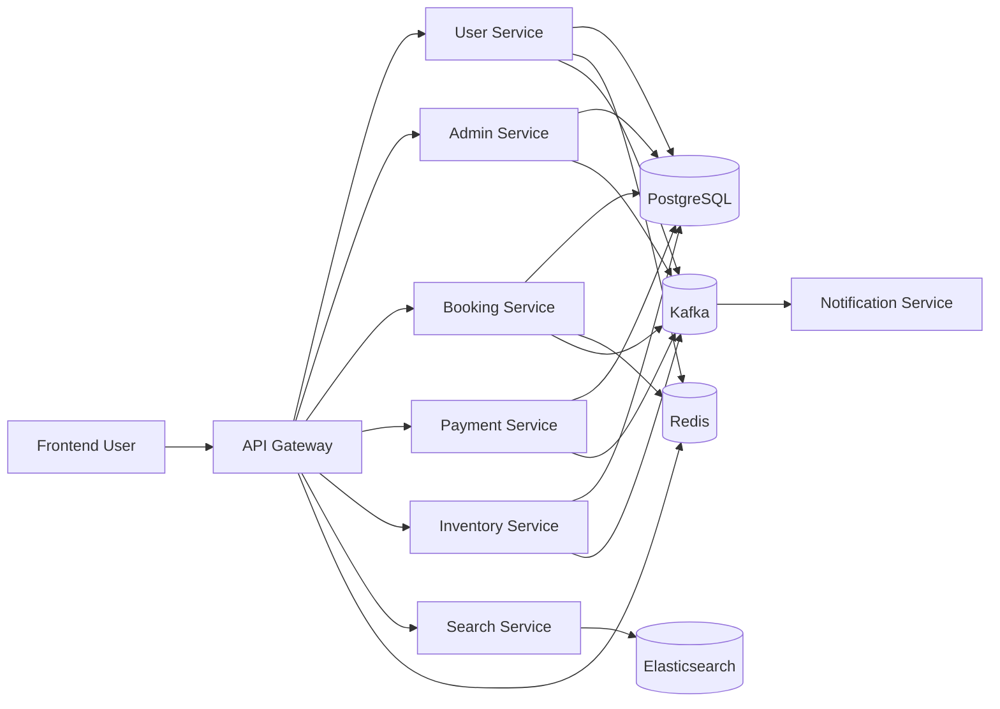
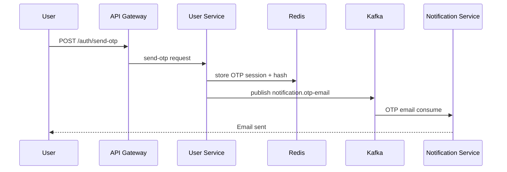
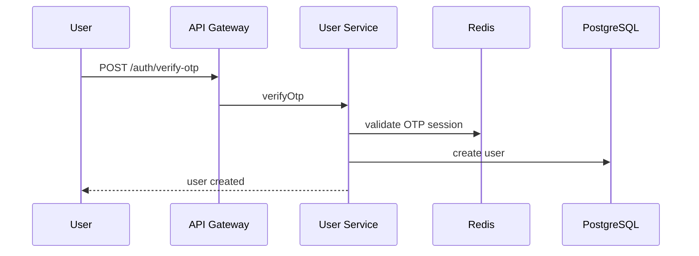
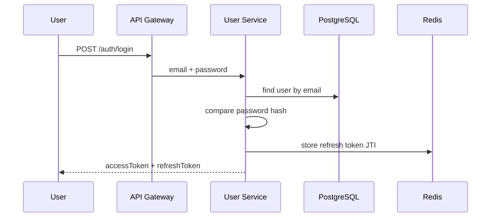
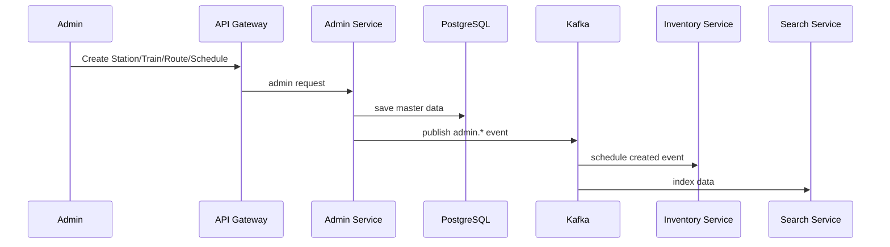
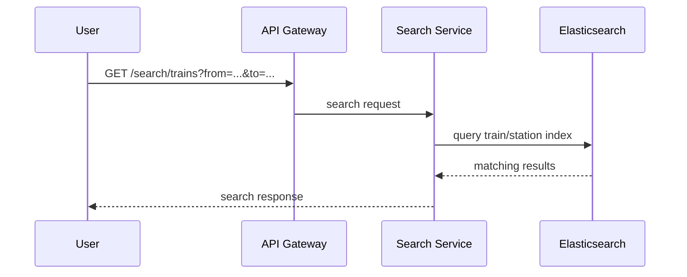
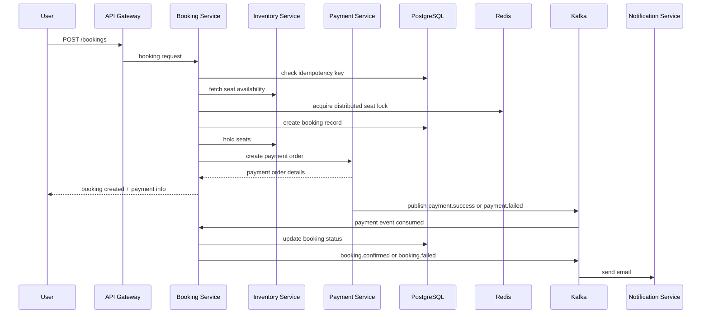
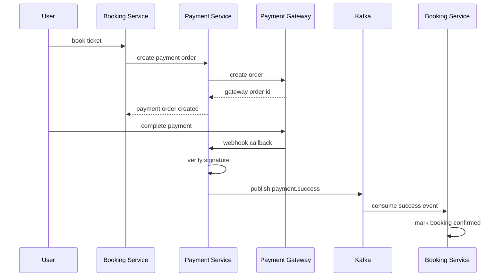

# IRCTC Backend Project Flow (Complete Guide in Hinglish)

Yeh document project ka complete business flow, system design, service responsibilities, aur request lifecycle explain karta hai. Isko beginner-friendly Hinglish me likha gaya hai taaki aapko project samajhne me easy ho.

---

## 1. Project kya hai?

Yeh project ek railway booking system ka microservices-based backend hai. Is project ka idea IRCTC jaisa booking app banana hai, lekin backend architecture enterprise-style me design kiya gaya hai.

Project me multiple services hain, har service apni responsibility maintain karta hai:

- Frontend UI
- API Gateway
- User Service
- Admin Service
- Inventory Service
- Booking Service
- Payment Service
- Search Service
- Notification Service

Sab services alag-alag modules me kaam karte hain aur aapse request API Gateway ke through aata hai.

---

## 2. Project ka core idea

Project ka main business flow is tarah hai:

1. Admin train, station, route aur schedule banaata hai.
2. Inventory service schedule ke liye seat availability track karta hai.
3. Search service trains aur stations ko index karta hai.
4. User signup/login karta hai.
5. User booking request bhejta hai.
6. Booking service seat lock karta hai.
7. Payment service payment order create karta hai.
8. Payment success/failure event Kafka ke through booking service ko milta hai.
9. Booking confirmed ya failed hota hai.
10. Notification service email bhejta hai.

Yeh flow microservices + event-driven architecture ka classic example hai.

---

## 3. High-Level Architecture (HLD)

Project ka architecture in layers me divide hai:

### 3.1 Presentation Layer
- Frontend React app
- User UI, login, search, booking, payment UI

### 3.2 API Gateway Layer
- Single entry point for all requests
- JWT validation
- rate limiting
- request forwarding

### 3.3 Business Services Layer
Har service apni business logic rakhta hai.

### 3.4 Data Layer
- PostgreSQL per service
- Redis for cache + session + locks
- Elasticsearch for search

### 3.5 Messaging Layer
- Kafka event-driven communication

### 3.6 External systems
- SendGrid for email
- Google OAuth for login
- Razorpay-like Payment Gateway for transactions

---

## 4. System design diagram

---

## 5. Project architecture ke important points

### 5.1 Microservices architecture
Har service independent kaam karta hai. Example:

- User service: auth & profile
- Admin service: railway data management
- Inventory service: seat availability
- Booking service: booking workflow
- Payment service: payment processing
- Search service: search index
- Notification service: email

### 5.2 Database per service
Har service apni own database rakhta hai. Isse coupling kam hota hai.

### 5.3 REST + Kafka
- REST: synchronous HTTP calls
- Kafka: asynchronous event-driven communication

### 5.4 Redis usage
Redis mainly use hota hai:
- OTP session storage
- refresh token storage
- user profile cache
- distributed seat locks
- rate limit counters

### 5.5 Kafka topics
Project me Kafka topics centralized hain in [shared/constants/kafka-topics.js](shared/constants/kafka-topics.js).

Examples:
- notification.otp-email
- notification.welcome-email
- admin.schedule-created
- payment.success
- booking.confirmed
- dlq.booking-service

---

## 6. Service-wise responsibilities

### 6.1 Frontend
- React app
- login/signup UI
- search trains
- booking page
- payment page

### 6.2 API Gateway
Base file: [api-gateway/src/index.js](api-gateway/src/index.js)

Gateway ka kaam:
- single entry point
- route forwarding
- JWT verification
- rate limiter
- security middleware
- proxying

Yeh service frontend ko actual backend service details hide karta hai.

### 6.3 User Service
Base files:
- [user-service/src/index.js](user-service/src/index.js)
- [user-service/src/services/auth.service.js](user-service/src/services/auth.service.js)
- [user-service/src/services/user.service.js](user-service/src/services/user.service.js)
- [user-service/prisma/schema.prisma](user-service/prisma/schema.prisma)

User service handle karta hai:
- signup
- login
- OTP verify
- Google login
- JWT creation
- profile fetch

### 6.4 Admin Service
Admin ka kaam hota hai railway master data manage karna.

Yeh service station, train, route, schedule create/update karta hai.

Admin service events publish karta hai:
- admin.train-created
- admin.station-created
- admin.route-created
- admin.schedule-created
- admin.schedule-cancelled

### 6.5 Inventory Service
Base file: [inventory-service/src/services/inventory.service.js](inventory-service/src/services/inventory.service.js)

Inventory service actual seat inventory maintain karta hai.

Yeh service:
- schedule inventory create karta hai
- seat data store karta hai
- seat availability calculate karta hai
- booking locks manage karta hai
- schedule cancellation ke baad seat state update karta hai

### 6.6 Booking Service
Base file: [booking-service/src/services/booking.service.js](booking-service/src/services/booking.service.js)

Booking service sabse critical workflow manage karta hai:
- user booking request accept karta hai
- seat validation
- Redis lock acquire karta hai
- booking DB row create karta hai
- inventory hold request bhejta hai
- payment order create karta hai
- payment result par booking status update karta hai

### 6.7 Payment Service
Base file: [payment-service/src/services/payment.service.js](payment-service/src/services/payment.service.js)

Payment service handle karta hai:
- payment order creation
- webhook validation
- payment success/failure
- publish payment events to Kafka

### 6.8 Search Service
Search service search functionality provide karta hai:
- train search
- station search
- index data from admin/inventory events

### 6.9 Notification Service
Notification service event consumer hota hai:
- OTP email
- welcome email
- booking confirmation email
- payment notification email

Yeh service direct HTTP endpoint nahi rakhta; sirf Kafka consumer hota hai.

---

## 7. Complete end-to-end flow

### 7.1 User signup + OTP flow

Then user enters OTP:

### 7.2 Login flow

### 7.3 Admin flow

### 7.4 Inventory initialization flow

Jab admin schedule create karta hai, to inventory service event consume karta hai.

1. Admin creates schedule
2. Admin service saves schedule in DB
3. Admin service Kafka event publish karta hai
4. Inventory service event consume karta hai
5. Inventory service scheduleInventory and seatInventory rows create karta hai
6. search service indexing ke liye event consume karta hai

### 7.5 Search flow

### 7.6 Booking flow

Ye project ka most important flow hai.

### 7.7 Payment flow

---

## 8. Why booking flow is special?

Yeh project booking logic me advanced patterns use karta hai:

### 8.1 Idempotency
Jab same booking request multiple times aata hai, to duplicate booking avoid hoti hai.

### 8.2 Distributed locking
Multiple users ek hi seat ko reserve karna chahte hain, to Redis lock use hota hai.

### 8.3 Saga pattern
Booking + payment + inventory ko complete transaction ki tarah ek hi process me manage nahi kiya gaya; instead step-by-step workflow maintain kiya gaya hai.

### 8.4 Compensation logic
Agar payment fail hota hai, to booking rollback ya failed status set hota hai.

---

## 9. LLD vs HLD in this project

### HLD (High Level Design)
HLD me system ka overall architecture samajha jata hai.

Examples:
- services ka interaction
- API Gateway architecture
- eventing via Kafka
- DB and cache choices
- deployment using Docker Compose

### LLD (Low Level Design)
LLD me ek specific module ke inside logic detail hota hai.

Examples:
- User login logic
- OTP generation logic
- Booking validation logic
- Payment validation and gateway call flow
- Redis lock details
- Prisma model design

Project me practical LLD files include:
- [user-service/src/services/auth.service.js](user-service/src/services/auth.service.js)
- [booking-service/src/services/booking.service.js](booking-service/src/services/booking.service.js)
- [payment-service/src/services/payment.service.js](payment-service/src/services/payment.service.js)
- [inventory-service/src/services/inventory.service.js](inventory-service/src/services/inventory.service.js)
- [user-service/prisma/schema.prisma](user-service/prisma/schema.prisma)

---

## 10. Key technical stack

### Backend
- Node.js
- Express.js
- Prisma ORM
- PostgreSQL
- Redis
- KafkaJS
- JWT
- bcrypt
- SendGrid
- Google OAuth
- Elasticsearch

### Frontend
- React
- Vite
- Tailwind CSS
- Axios
- Zustand

### Infra
- Docker Compose
- pgAdmin
- RedisInsight
- Kafka UI
- Kibana

---

## 11. Practical project flow in one line

Agar aapko ek sentence me samajhna ho, to:

“Frontend se request API Gateway ke through aata hai, User/Admin/Booking/Payment services apni tasks complete karte hain, event-driven communication Kafka ke through hota hai, data PostgreSQL/Redis/Elasticsearch me stored rehta hai, aur final ticket booking lifecycle payment + notification + seat inventory ke saath complete hota hai.”

---

## 12. File structure summary

Yeh repo important folders dekh sakta hai:

- [api-gateway](api-gateway)
- [admin-service](admin-service)
- [user-service](user-service)
- [booking-service](booking-service)
- [payment-service](payment-service)
- [inventory-service](inventory-service)
- [search-service](search-service)
- [notification-service](notification-service)
- [frontend](frontend)
- [shared](shared)
- [docker-compose.yml](docker-compose.yml)
- [README.md](README.md)

---

## 13. Final takeaway

Yeh project ek full-stack microservices railway system ka realistic example hai. Yahan aapko multiple industry patterns milte hain:

- microservices
- event-driven design
- API gateway
- JWT auth
- DB-per-service
- Redis caching/locking
- Kafka messaging
- saga orchestration
- idempotency
- DLQ and retries

Ye sab modern backend architecture ke core concepts hain, isliye yeh project interview aur real-world learning ke liye bahut useful hai.

---

## 14. Next step for learning

Agar aapko aur deeper understanding chahiye, to next steps ho sakte hain:

1. User service ka auth flow explain karna
2. Booking service ka saga flow step-by-step
3. Kafka topic list aur event propagation
4. Prisma schema aur relationships explain karna
5. API Gateway routing logic explain karna

---

Yeh file project ka complete flow samjhane ke liye banaayi gayi hai. Aap isko reference ke roop me use kar sakte ho aur apne notes ke saath extend bhi kar sakte ho.

---

# 15. Interview Concepts: Questions and Answers

Neeche diye gaye answers interview me directly explain kiye ja sakte hain. Har answer ko project ke actual flow se relate karke bola gaya hai.

## 15.1 Architecture and HLD

### Q1. Is project me microservices architecture kyun use ki?

**Answer:** Railway system ke alag business domains ko independent services me divide kiya gaya hai. User, booking, payment, inventory aur search ko independently develop, deploy aur scale kiya ja sakta hai. Isse ek service ki failure poore system ko directly affect nahi karti. Tradeoff ye hai ki distributed systems ki complexity badh jaati hai, jaise network failures, eventual consistency aur distributed transactions.

### Q2. Service boundaries kaise decide kiye?

**Answer:** Boundaries business responsibility aur data ownership ke basis par decide ki gayi hain. User service identity own karta hai, admin service railway master data, inventory service seats, booking service booking lifecycle aur payment service payment lifecycle own karta hai. Ye bounded-context approach hai.

### Q3. API Gateway ki zarurat kyun hai?

**Answer:** Frontend ko har service ka URL pata na ho, isliye gateway single entry point provide karta hai. Gateway authentication, rate limiting, request routing, circuit breaker aur common security middleware handle karta hai. Client ko internal service topology expose nahi hoti.

### Q4. REST aur Kafka me kya difference hai?

**Answer:** REST synchronous request-response communication hai; caller response ka wait karta hai. Kafka asynchronous event communication hai; producer event publish karta hai aur consumer baad me process karta hai. Booking ke immediate seat/payment calls ke liye REST, aur payment result, notifications, indexing jaise decoupled flows ke liye Kafka use hua hai.

### Q5. Database-per-service pattern kya hai?

**Answer:** Har service apne data ka owner hai aur doosri service ki database tables directly access nahi karti. Isse coupling kam hoti hai aur independent scaling possible hoti hai. Cross-service data ke liye internal REST API ya Kafka events use hote hain. Iska drawback distributed queries aur consistency management hai.

### Q6. Is architecture ki main tradeoffs kya hain?

**Answer:** Benefits hain independent deployment, fault isolation, team ownership aur selective scaling. Costs hain network latency, operational complexity, duplicate data, monitoring difficulty, eventual consistency aur Saga ki need.

## 15.2 Booking, Saga and Consistency

### Q7. Booking flow explain kijiye.

**Answer:** Booking service request validate karta hai, idempotency key check karta hai, inventory se availability fetch karta hai, Redis me seat lock acquire karta hai, booking record create karta hai, inventory me seats hold karta hai aur payment order banwata hai. Payment webhook ke baad payment service Kafka event publish karta hai. Booking service event consume karke booking confirm ya fail karta hai.

### Q8. Saga pattern kya hai?

**Answer:** Saga distributed transaction ko chhote local transactions me divide karta hai. Is project me forward steps `HOLD_SEATS`, `CREATE_PAYMENT` aur `CONFIRM_SEATS` hain. Kisi step par failure aaye to completed steps ke compensating actions reverse order me run hote hain, jaise seats release karna aur refund initiate karna.

### Q9. Two-phase commit ke bajay Saga kyun?

**Answer:** Services ke databases aur external payment gateway ko ek distributed database transaction me safely include karna practical nahi hota. Saga local commits aur compensating actions use karta hai, isliye services loosely coupled rehti hain. Iske badle system ko temporary intermediate states aur eventual consistency handle karni padti hai.

### Q10. Booking state machine kya hai?

**Answer:** Booking statuses lifecycle ko represent karte hain: `PENDING` se `SEATS_HELD`, phir `PAYMENT_PENDING`, aur payment successful hone par `CONFIRMED`. Failure cases me `FAILED`, `EXPIRED` ya `CANCELLED` status aata hai. Status transitions ko validate karna zaroori hai, warna invalid state jaise failed booking ko confirm karna possible ho sakta hai.

### Q11. Payment success ke baad confirmation fail ho to kya hoga?

**Answer:** Booking service event ko process karke confirmation step execute karega. Agar confirmation fail ho, Saga compensation payment refund aur seat release attempt karegi. Saga logs recovery aur audit ke liye rakhe gaye hain. Compensation bhi idempotent honi chahiye, kyunki retry ke dauran same action dobara aa sakta hai.

### Q12. Eventual consistency kya hai?

**Answer:** Admin database me schedule save hone aur Search/Inventory ke update hone ke beech chhota delay ho sakta hai. Kafka event consumer process hone ke baad read models update hote hain. Iska matlab har component immediately consistent nahi, lekin kuch time ke baad system consistent ho jaata hai.

## 15.3 Idempotency and Concurrency

### Q13. Idempotency kya hai aur project me kaise use hui?

**Answer:** Same request ko multiple baar process karne par same logical result milna idempotency hai. Booking aur payment me idempotency key ko database ke unique field/record ke saath store kiya gaya hai. Duplicate request par existing response return hota hai aur duplicate booking/order create nahi hota.

### Q14. Kafka duplicate event aaye to?

**Answer:** Kafka consumers ko at-least-once delivery ke wajah se duplicate event mil sakta hai. Consumer event key ya idempotency record check karke already processed event skip karta hai. Event handlers ko naturally idempotent banana bhi zaroori hai.

### Q15. Distributed lock kyun use kiya?

**Answer:** Multiple booking-service instances ya users same seat ko same time par reserve kar sakte hain. Redis distributed lock temporary ownership establish karta hai. Project Lua script se all requested seat locks ko all-or-nothing acquire karta hai; agar ek seat unavailable ho to pehle acquired locks rollback ho jaate hain.

### Q16. Redis lock kaise safe banaya gaya?

**Answer:** Lock `SET NX EX` se acquire hota hai, isliye existing key overwrite nahi hoti aur TTL ke baad stale lock expire ho jaata hai. Release ke waqt lock value compare hoti hai, isliye ek process doosre process ka lock release nahi kar sakta. Seat IDs sort karke overlapping requests ke deadlock chances kam kiye gaye hain.

### Q17. Redis lock aur database lock me difference?

**Answer:** Redis lock distributed application-level coordination ke liye fast hai aur short-lived reservation ke liye useful hai. Database row lock transaction ke andar strong consistency deta hai, lekin long-running request ke liye connection hold kar sakta hai. Project dono ko use karta hai: Redis preliminary lock ke liye aur database transaction/row locking final consistency ke liye.

### Q18. Optimistic locking kya hai?

**Answer:** Record ke saath version number store hota hai. Update tabhi hota hai jab current version expected version ke equal ho; successful update version increment karta hai. Agar kisi aur process ne pehle update kar diya, update count zero hota hai aur stale-state error return hota hai.

### Q19. `FOR UPDATE NOWAIT` ka purpose kya hai?

**Answer:** Inventory transaction affected seat row ko lock karke concurrent modification prevent karta hai. `NOWAIT` ka matlab row already locked ho to wait karne ke bajay immediately failure return karo. Isse booking request indefinitely block nahi hoti.

## 15.4 Kafka, Retry and Resilience

### Q20. Kafka topic, partition, offset aur consumer group kya hain?

**Answer:** Topic event category hai, partition topic ka ordered log segment hai, offset message ka position hai, aur consumer group consumers ka logical group hai. Same partition ke messages order me process hote hain. Multiple partitions consumers ke beech parallel processing enable karte hain.

### Q21. Kafka consumer fail ho to kya hota hai?

**Answer:** Handler error throw karta hai to message redeliver/retry ho sakta hai. Project me limited retries ke baad message per-service DLQ topic me bheja jaata hai, jisse poison message consumer ko permanently block nahi karta.

### Q22. DLQ kya hai?

**Answer:** Dead-Letter Queue failed messages ko alag topic me store karti hai. Project DLQ message ke saath original topic, partition, offset, error aur timestamp headers me rakhta hai. Operations team baad me message inspect, fix aur replay kar sakti hai.

### Q23. Retry kab dangerous hota hai?

**Answer:** Permanent validation error par retry useless hota hai, aur high traffic me retry storm create kar sakta hai. Retry sirf temporary failures jaise timeout ya transient network issue par bounded count, backoff aur timeout ke saath karna chahiye. Non-retryable errors ko directly DLQ ya failure response dena chahiye.

### Q24. Circuit breaker kya solve karta hai?

**Answer:** Agar downstream service repeatedly fail ho rahi ho, circuit breaker calls ko temporarily stop karke fast failure deta hai. Closed state normal hai, Open state calls block karti hai, aur Half-open state limited test requests se recovery check karti hai. Isse cascading failure prevent hoti hai.

### Q25. Rate limiting kaise kaam karti hai?

**Answer:** Gateway endpoint ya IP/user ke basis par request count limit karta hai. Redis counters aur expiry windows use karke OTP, login, search aur booking routes ke different limits enforce kiye jaate hain. Isse brute force, abuse aur overload kam hota hai.

## 15.5 Authentication and Security

### Q26. Access token aur refresh token me difference?

**Answer:** Access token short-lived hota hai aur APIs access karne ke liye use hota hai. Refresh token long-lived hota hai aur naya access token issue karne ke liye use hota hai. Short access-token lifetime exposure ka impact reduce karti hai.

### Q27. Refresh token rotation kya hai?

**Answer:** Har refresh request par purana refresh token invalid karke naya access aur refresh token issue kiya jaata hai. Project refresh token ka `jti` Redis me device-specific key ke saath rakhta hai. Old JTI reuse mile to session revoke karke re-login require kiya jaata hai.

### Q28. OTP ko Redis me kyun rakha?

**Answer:** OTP temporary data hai, isliye TTL, fast read/write aur automatic expiry ke liye Redis suitable hai. Raw OTP store nahi hota; HMAC hash store hota hai. Rate limit aur failed-attempt counter bhi Redis me maintain hote hain.

### Q29. HMAC aur timing-safe comparison kyun?

**Answer:** HMAC secret ke saath OTP ka digest banata hai, isliye Redis leak hone par raw OTP directly available nahi hota. `timingSafeEqual` comparison timing-based attacks ka risk reduce karta hai. OTP expiry aur maximum attempts brute force risk ko limit karte hain.

### Q30. Cookie security kaise implement hui?

**Answer:** Access aur refresh tokens HttpOnly cookies me set hote hain, jisse browser JavaScript unhe directly read nahi kar sakta. Production me Secure aur Strict SameSite settings use hoti hain. Real deployment me CSRF protection aur proper HTTPS bhi ensure karna chahiye.

### Q31. Internal service authentication kya hai?

**Answer:** Gateway/user authentication aur service-to-service authentication alag concerns hain. Internal endpoints `x-internal-service-key` validate karte hain, taaki public client sensitive operations call na kar sake. Production me static shared key ke saath mTLS, short-lived service tokens ya cloud identity better options ho sakte hain.

### Q32. Password security kaise handle hui?

**Answer:** Password bcrypt se hash hota hai aur plain password database me store nahi hota. Response me password field remove ki jaati hai. JWT secrets, API keys aur database URLs environment variables me hone chahiye; repository me hardcoded fallback secrets ko production me replace karna zaroori hai.

### Q33. Payment webhook secure kaise hai?

**Answer:** Payment gateway ke webhook signature ko raw request body ke against verify kiya jaata hai. Invalid signature reject hoti hai. Payment order status aur idempotency check se duplicate webhook ko dobara capture/event publish karne se roka jaata hai.

## 15.6 Database and Search

### Q34. Prisma ORM ka role kya hai?

**Answer:** Prisma type-safe database client, schema definition, relations, migrations aur transactions provide karta hai. Models me unique constraints, indexes, foreign-key relations aur cascade behavior define kiya gaya hai. Service apne Prisma schema ke through apni database ownership maintain karta hai.

### Q35. Database transaction ki zarurat kahan hai?

**Answer:** Multiple related writes ko all-or-nothing rakhne ke liye transaction use hoti hai. Example: inventory initialize karte waqt schedule, seats, route stops aur idempotency record ko consistent rakhna. External HTTP/Kafka call ko long database transaction ke andar rakhna avoid karna chahiye.

### Q36. Database indexes kyun use hue?

**Answer:** Frequently searched columns jaise `userId`, `scheduleId`, `status` aur `lockExpiresAt` par indexes query speed improve karte hain. Unique indexes duplicate data prevent karte hain. Tradeoff ye hai ki indexes storage lete hain aur writes/updates ko thoda expensive banate hain.

### Q37. Elasticsearch PostgreSQL ke saath kyun use hua?

**Answer:** PostgreSQL transactional source of truth hai, jabki Elasticsearch fast full-text search, autocomplete aur filtering ke liye optimized hai. Admin events ke through search index update hota hai. Isliye search read model eventually consistent ho sakta hai.

### Q38. Search index fail ho jaye to?

**Answer:** Original admin database data lose nahi hota, kyunki woh source of truth hai. Kafka event retry/DLQ ke through index update recover kiya ja sakta hai. Production me full re-index job bhi honi chahiye jo source database se Elasticsearch rebuild kare.

### Q39. Segment booking kaise work karti hai?

**Answer:** Route stations ko sequence numbers milte hain. Seat availability segment ke active locks ke basis par calculate hoti hai. Same seat non-overlapping segments ke liye reuse ho sakti hai, lekin overlapping segment ko database transaction aur segment lock conflict detect karke reject kiya jaata hai.

## 15.7 LLD, Operations and Deployment

### Q40. Route, controller aur service layer ka role kya hai?

**Answer:** Route URL aur middleware attach karta hai. Controller request validation aur HTTP response handle karta hai. Service business rules, database calls aur external integrations handle karta hai. Is separation se testing, maintenance aur code ownership easy hoti hai.

### Q41. Centralized error handling kyun?

**Answer:** Har controller me alag response format likhne ke bajay custom error classes aur common middleware consistent status code, message aur error code return karte hain. Internal stack trace client ko expose nahi karni chahiye; detailed error logs server side par hone chahiye.

### Q42. Graceful shutdown kya hai?

**Answer:** Shutdown signal par service naye work ko stop karti hai, existing HTTP requests complete hone deti hai, phir Kafka producer aur database/Redis connections close karti hai. Isse in-flight requests aur messages corrupt ya abruptly terminate nahi hote.

### Q43. Docker Compose ka role kya hai?

**Answer:** Docker Compose local environment me Postgres, Redis, Kafka, Zookeeper, Elasticsearch aur monitoring tools ko reproducibly start karta hai. Shared bridge network container-to-container communication enable karta hai. Production me managed services, secrets manager, backups aur multi-node deployment consider karna chahiye.

### Q44. Liveness aur readiness me difference?

**Answer:** Liveness batata hai process alive hai ya nahi. Readiness batata hai service traffic accept karne ke liye dependencies ke saath ready hai ya nahi. Sirf HTTP 200 health endpoint ko production readiness ka complete proof nahi maana ja sakta.

### Q45. System ko high traffic ke liye kaise scale karoge?

**Answer:** Stateless Node services ko horizontal replicas ke saath load balancer ke peeche scale karunga. Kafka partitions aur consumer instances increase karunga, Redis ko highly available/clustered banaunga, PostgreSQL indexes/read replicas/connection pooling use karunga, aur search ko Elasticsearch cluster me scale karunga. Booking path par strict idempotency, locking aur rate limiting maintain rahenge.

### Q46. Observability kaise improve karoge?

**Answer:** Structured logs, correlation ID, request ID, Kafka topic/partition/offset, metrics aur distributed tracing add karunga. Important metrics honge: booking success rate, payment failure rate, lock conflict rate, consumer lag, DLQ count, API latency aur database errors. Health, metrics aur alerting ko alag concerns rakhunga.

---

## 16. Interview me project ko 60 seconds me kaise explain karein?

“Yeh IRCTC-style railway booking system microservices architecture par based hai. Frontend API Gateway ke through User, Admin, Search, Booking, Payment aur Inventory services se communicate karta hai. Synchronous operations ke liye REST aur asynchronous workflows ke liye Kafka use hua hai. Har service apna database own karti hai; Redis OTP, caching, rate limiting aur distributed seat locks ke liye use hota hai, while Elasticsearch train search ke liye use hota hai. Booking flow me idempotency, Redis locking, optimistic concurrency aur Saga orchestration hai. Payment webhook verify hone ke baad Kafka event booking service ko confirm/fail karta hai, aur Notification service email bhejti hai. Failures ke liye retry, compensation, circuit breaker aur DLQ patterns use kiye gaye hain.”

## 17. Honest limitations jo interview me mention karni chahiye

- [user-service/src/controllers/user.controller.js](user-service/src/controllers/user.controller.js) me `updateProfile` aur `deleteProfile` abhi TODO hain.
- Current DLQ retry tracker in-memory hai; service restart par retry state lose ho sakti hai.
- Docker Compose learning/development setup hai; production ke liye high availability, backups, secret manager aur monitoring add karni hogi.
- Internal shared service key ko production me stronger service identity/mTLS se replace karna better hoga.
- Kafka publish aur database update ke beech atomicity ke liye production-grade outbox pattern consider karna chahiye.

---

# 18. 3-Day Scratch-Build Roadmap

Yeh roadmap ek **working learning MVP** ko scratch se banane ke liye hai. Isse 3 din me production-ready system samajhna ya banana realistic nahi hai; target hai ki core booking flow local machine par end-to-end chale. Har din lagbhag 8 focused coding hours assume kiye gaye hain, breaks alag hain.

## Day 1: Foundation, User aur Railway Master Data

**Din ka goal:** Local infrastructure ready ho, service conventions set hon, aur user/admin APIs se basic data create ho.

| Time | Milestone | Kya banana hai / kaise karna hai |
|---|---|---|
| 09:00-10:00 | Scope aur contracts | Pehle MVP endpoints aur entities likho: User, Station, Train, Route, Schedule. Har API ka request/response aur Kafka event ka naam/payload decide karo. Service boundaries aur ports note karo. |
| 10:00-11:00 | Repo skeleton | Har service me `src/index.js`, config, routes, controllers, services aur middleware folders banao. Shared error/async-handler aur common response shape define karo. Har HTTP service me `/health` endpoint add karo. |
| 11:00-12:00 | Infrastructure | `.env.example` files banao; `docker-compose up -d` se Postgres, Redis, Kafka aur Elasticsearch start karo. `docker ps` aur dependency health endpoints se verify karo. |
| 12:00-13:00 | User DB | User service Prisma schema me User/AuthProvider models, unique email aur required indexes define karo. `npx prisma migrate dev --name init` aur `npx prisma generate` chalao. |
| 14:00-15:30 | User auth MVP | Signup/login, bcrypt password hashing aur JWT issue/verify implement karo. Pehle email OTP ko local dev stub rakho; real email/Google OAuth ko core booking flow ke baad jodo. |
| 15:30-17:00 | Admin CRUD | Admin service me Station, Train, Route aur Schedule ke Prisma models aur basic create/list APIs banao. Input validation aur consistent error handling add karo. |
| 17:00-18:00 | Day-end demo | Admin API se stations, train, route, schedule create karo; database me verify karo. User signup/login aur `/health` ko Postman/curl se check karo. |

**Milestone complete jab:** infrastructure chal rahi ho, migrations reproducible hon, login token milta ho, aur schedule master data API se persist hota ho.

## Day 2: Kafka, Inventory aur Search

**Din ka goal:** Schedule create hone ke baad events se inventory aur search data initialize ho.

| Time | Milestone | Kya banana hai / kaise karna hai |
|---|---|---|
| 09:00-10:00 | Event contracts | `shared/constants/kafka-topics.js` me topics aur payload contracts define karo. Admin schedule create ke baad `admin.schedule-created` event publish karo; event me schedule, route/stops aur seat configuration ke liye required IDs hon. |
| 10:00-12:00 | Inventory schema | Inventory service ke Prisma models banao: ScheduleInventory, SeatInventory aur segment/stop sequence data. Schedule-created consumer ko idempotent banao, taaki same event dobara aaye to duplicate seats na banein. |
| 12:00-13:00 | Availability APIs | Route segment aur date ke input par available seats return karne wala endpoint banao. Empty schedule, invalid station order aur no-seat cases test karo. |
| 14:00-15:30 | Seat hold/release | Redis me TTL-based seat locks implement karo. Requested seat locks all-or-nothing acquire hon; expiry, ownership-check release aur hold/release endpoints verify karo. |
| 15:30-16:30 | Search indexing | Search service me station/train index aur admin events consume karke index update karne ka basic flow banao. Local Elasticsearch query se station/train search test karo. |
| 16:30-18:00 | Event integration | Admin se schedule create karo; Kafka UI me event dekho; inventory rows aur Elasticsearch document verify karo. Consumer error logging, bounded retry aur DLQ handling ka basic path add karo. |

**Milestone complete jab:** ek schedule create karne se Kafka event publish ho, inventory seats initialize hon, aur search API train/station result de.

## Day 3: Booking, Payment, Gateway aur Demo

**Din ka goal:** User search se booking request tak jaye aur payment result booking status update kare.

| Time | Milestone | Kya banana hai / kaise karna hai |
|---|---|---|
| 09:00-10:30 | Booking API | Booking schema/statuses aur `POST /bookings` banao. User, schedule, journey segment aur passengers validate karo; idempotency key par duplicate request me existing booking return karo. |
| 10:30-12:00 | Booking orchestration | Availability check -> Redis seat lock -> booking record -> inventory hold ko sequence me implement karo. Har failure par booking status aur held seats ko safely compensate/release karo. |
| 12:00-13:00 | Payment MVP | Payment order create API aur local mock provider banao. Payment webhook signature verification ka interface rakho; success/failure par idempotent `payment.success` / `payment.failed` Kafka event publish karo. |
| 14:00-15:00 | Booking consumer | Booking service payment events consume kare. Success par booking confirm aur seats finalize; failure par booking fail aur seats release. Duplicate event replay karke idempotency verify karo. |
| 15:00-16:00 | API Gateway | Service routes/proxy aur JWT middleware connect karo. Gateway se public search, protected booking aur admin route smoke-test karo. |
| 16:00-17:00 | Frontend MVP | Search form/results, login state aur booking confirmation screen banao. Frontend `/api` requests gateway ko bheje; real payment UI ke bajay mock payment success action use karo. |
| 17:00-18:00 | End-to-end test | Fresh schedule se search -> login -> booking -> mock payment success -> confirmed status test karo. Duplicate booking, unavailable seat, payment failure, missing dependency aur frontend production build check karo. |

**Milestone complete jab:** ek happy-path booking end-to-end confirm ho aur failure/duplicate cases seats ya booking data ko inconsistent na chhodein.

## Build Order aur Daily Rules

1. Ek milestone ko working aur testable banaye bina next service par mat jao. Har API ko pehle direct service par test karo, phir gateway ke through.
2. Har service ka apna `.env`, database ownership aur Prisma migration rakho. Secrets git me commit mat karo.
3. External integrations ko pehle mock karo: email, Google OAuth aur payment gateway. Core flows chalne ke baad real credentials/config add karo.
4. Kafka handlers aur booking/payment endpoints ko duplicate event/request ke against idempotent rakho.
5. Har din ke end par code commit apne local git workflow ke mutabik karo aur working state note karo.

## 3 Din ke Baad Kya Bachega

3 din ke baad expected result learning MVP hai, production release nahi. Agle iteration me real email/payment integration, automated unit/integration tests, outbox pattern, persistent retry state, observability, security review, load testing aur deployment hardening karo. Agar 3 din me delay aaye, pehle frontend polish, Google OAuth, Kibana dashboards aur advanced circuit-breaker behavior defer karo; booking consistency aur failure handling ko nahi.
